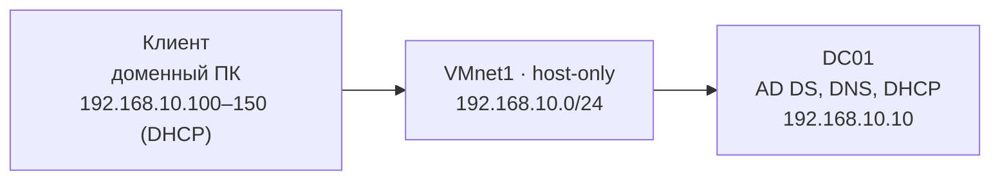

# AD-lab

Лаборатория Windows Server + Active Directory: контроллер домена, DNS, DHCP, структура OU и PowerShell-скрипты для развёртывания.

## Что это

Учебный стенд из двух виртуальных машин на VMware: контроллер домена DC01 (Windows Server 2022 Standard, редакция с Desktop Experience, роли AD DS, DNS и DHCP) и клиентский компьютер с Windows 11, который входит в домен `lab.local` и получает адрес по DHCP. Обе машины подключены к host-only сети VMnet1, интернет стенду не нужен.

Стенд собран, чтобы отработать на практике то, с чем сталкивается junior-системный администратор: развёртывание контроллера домена, прямую и обратную зоны DNS, DHCP-scope с авторизацией в AD, структуру подразделений и групп, массовое создание пользователей из CSV.

Установка Windows Server, настройка сети, установка ролей и повышение сервера до контроллера домена делаются вручную — это шаги 1–6 ниже. Скрипты из `scripts\` запускаются уже в готовом домене: создают OU, группы и пользователей, настраивают DHCP-scope и проверяют, что стенд работает.

**Требования.** PowerShell 5.1, консоль администратора, VMware Workstation, две виртуальные машины. Интернет стенду не нужен.

## Схема стенда



Интернет не требуется: клиент и контроллер домена общаются внутри сети `192.168.10.0/24`, внешний DNS не используется.

## IP-план

| Узел | Роль | Адрес | Примечание |
| --- | --- | --- | --- |
| DC01 | AD DS, DNS, DHCP | `192.168.10.10/24` | статический |
| Клиент | доменный ПК | `192.168.10.100–150` | получает по DHCP |
| VMnet1 | host-only | `192.168.10.0/24` | внешняя сеть не нужна |

## Шаги

### 1. Установка Windows Server

```text
VMware Workstation → New Virtual Machine → Typical
  Installer disc image file (ISO): образ Windows Server 2022 Standard
  Virtual machine name: DC01
  Disk size: 40 GB
  Customize Hardware → Network Adapter → Custom (VMnet1)
Установка: редакция с «Desktop Experience»
```

**Что делает.** Создаёт виртуальную машину контроллера домена и ставит Windows Server с графической оболочкой. Клиентская машина создаётся так же, только на неё ставится Windows 11, а её сетевой адаптер тоже подключается к VMnet1.

**Как проверить.** После установки войти в систему, выполнить `Get-ComputerInfo | Select-Object WindowsProductName, CsName` — выводится установленная редакция и имя компьютера.

### 2. Имя хоста и статический IP

```powershell
Get-NetAdapter                                                          # имя адаптера может отличаться; ниже — Ethernet0
New-NetIPAddress -InterfaceAlias 'Ethernet0' -IPAddress '192.168.10.10' -PrefixLength 24
Set-NetIPInterface -InterfaceAlias 'Ethernet0' -Dhcp Disabled
Set-DnsClientServerAddress -InterfaceAlias 'Ethernet0' -ServerAddresses '192.168.10.10'
Rename-Computer -NewName 'DC01' -Restart
```

**Что делает.** Задаёт контроллеру домена постоянный адрес `192.168.10.10/24` без шлюза (в host-only сети шлюза нет), отключает DHCP на адаптере, указывает в качестве DNS-сервера самого себя и переименовывает машину в DC01. Внешний DNS на сетевом адаптере контроллера указывать нельзя: иначе DC не зарегистрирует свои записи в собственной зоне. В Virtual Network Editor задайте для VMnet1 подсеть `192.168.10.0/24` и отключите её DHCP: иначе собственный DHCP VMware выдаёт клиентам адреса из этой же подсети, и они столкнутся с диапазоном Windows-scope.

**Как проверить.** `Get-NetIPAddress -InterfaceAlias 'Ethernet0' -AddressFamily IPv4 | Select-Object IPAddress, PrefixLength, PrefixOrigin` — адрес `192.168.10.10`, `PrefixOrigin` = Manual; `Get-NetIPInterface -InterfaceAlias 'Ethernet0' -AddressFamily IPv4` — `Dhcp` = `Disabled`; `Get-DnsClientServerAddress -InterfaceAlias 'Ethernet0'` — сервер `192.168.10.10`; `hostname` — `DC01`.

### 3. Роль AD DS

```powershell
Install-WindowsFeature -Name AD-Domain-Services -IncludeManagementTools
```

**Что делает.** Устанавливает роль доменных служб Active Directory и консоли управления вместе с модулем PowerShell `ActiveDirectory` (командлеты `Get-ADDomain`, `New-ADUser` и остальные).

**Как проверить.** `Get-WindowsFeature -Name AD-Domain-Services | Select-Object Name, InstallState` — `Installed`; `Get-Module -ListAvailable ActiveDirectory` — модуль найден.

### 4. Повышение до контроллера домена

```powershell
Install-ADDSForest -DomainName 'lab.local' -DomainNetbiosName 'LAB' -InstallDns -Force:$true
```

**Что делает.** Создаёт новый лес и домен `lab.local`, повышает DC01 до контроллера домена, устанавливает DNS и перезагружает сервер. Мастер запросит пароль режима восстановления служб каталогов (DSRM). С этого момента домен существует: можно запускать `New-LabOUs.ps1` и `New-LabUsers.ps1`; для DHCP-scope и проверки стенда сначала понадобится роль DHCP из шага 6.

**Как проверить.** После перезагрузки, под учётной записью `LAB\Administrator` (пароль — того локального администратора, что задан при установке; при повышении мастер спрашивает только пароль DSRM): `Get-ADDomain | Select-Object DNSRoot, NetBIOSName` — `lab.local` и `LAB`; `Get-Service NTDS, DNS, Netlogon | Select-Object Name, Status` — все три службы `Running`.

### 5. DNS

```powershell
Add-DnsServerPrimaryZone -NetworkId '192.168.10.0/24' -ReplicationScope 'Domain'
Add-DnsServerForwarder -IPAddress '8.8.8.8','1.1.1.1'    # только если у ВМ есть интернет
```

**Что делает.** Создаёт зону обратного просмотра `10.168.192.in-addr.arpa` (имя выводится из `-NetworkId`) для PTR-записей. Forwarders отправляют запросы, которых нет в локальных зонах, на внешние DNS-серверы; без интернета эта строка не нужна и её можно пропустить. Forwarders и `w32tm /resync` заработают, только если временно добавить ВМ второй сетевой адаптер в режиме NAT; без него эти шаги пропускаются, и стенд остаётся с прежним правилом — внешний DNS не используется.

**Как проверить.** `Get-DnsServerZone | Select-Object ZoneName, ZoneType, IsDsIntegrated` — в списке есть `lab.local` и `10.168.192.in-addr.arpa`; `Resolve-DnsName 'DC01'` — `192.168.10.10`; `Resolve-DnsName '192.168.10.10'` — PTR `DC01.lab.local`. Если PTR не появился, выполнить `ipconfig /registerdns` и проверить снова.

### 6. DHCP

```powershell
Install-WindowsFeature -Name DHCP -IncludeManagementTools
Add-DhcpServerSecurityGroup
Add-DhcpServerv4Scope -Name 'Lab 192.168.10.0' -StartRange '192.168.10.100' -EndRange '192.168.10.150' -SubnetMask '255.255.255.0' -State Active
Set-DhcpServerv4OptionValue -ScopeId '192.168.10.0' -OptionId '003' -Value '192.168.10.1'
Set-DhcpServerv4OptionValue -ScopeId '192.168.10.0' -OptionId '006' -Value '192.168.10.10'
Set-DhcpServerv4OptionValue -ScopeId '192.168.10.0' -OptionId '015' -Value 'lab.local'
Add-DhcpServerInDC -DnsName 'DC01.lab.local' -IPAddress '192.168.10.10'
Restart-Service DHCPServer
```

**Что делает.** Устанавливает роль DHCP, создаёт и сразу активирует scope `192.168.10.0/24` с диапазоном `192.168.10.100–150`, задаёт опции 003 (маршрутизатор), 006 (DNS-сервер `192.168.10.10`) и 015 (доменное имя `lab.local`), затем авторизует DHCP-сервер в Active Directory — без авторизации в домене служба адреса не выдаёт. Опция 003 отдаёт клиентам шлюз `192.168.10.1`, хотя в host-only сети такого шлюза нет: в `ipconfig /all` он будет показан как основной шлюз и будет недоступен. В этом стенде так и задумано, домену это не мешает — весь трафик идёт внутри подсети.

**Как проверить.** `Get-DhcpServerInDC` — в списке `DC01.lab.local` / `192.168.10.10`; `Get-DhcpServerv4Scope` — `State` = `Active`. На клиенте: `ipconfig /release`, `ipconfig /renew`, `ipconfig /all` — адрес из диапазона, DNS-сервер `192.168.10.10`, DNS-суффикс `lab.local`, шлюз `192.168.10.1` (недоступен — так и задумано). Затем вход в домен из PowerShell от имени администратора: `Add-Computer -DomainName 'lab.local' -Credential (Get-Credential)` с учётной записью доменного администратора, перезагрузка и вход как `LAB\i.petrov` (учётные записи из CSV создаются с требованием сменить пароль при первом входе).

## Скрипты

Все четыре скрипта запускаются на DC01 в PowerShell от имени администратора. `New-LabOUs.ps1` и `New-LabUsers.ps1` работают в готовом домене, то есть после шага 5; `New-LabDhcpScope.ps1` и `Test-Lab.ps1` — после шага 6, когда установлена роль DHCP: без модуля `DhcpServer` они завершатся ошибкой. Параметры у них необязательные, значения по умолчанию совпадают с этим стендом.

| Скрипт | Что делает | Пример запуска |
| --- | --- | --- |
| `scripts\New-LabOUs.ps1` | Создаёт 10 подразделений: `Lab`, `Lab\Users` с отделами IT, Finance, Sales, Support, `Lab\Groups`, `Lab\Computers` с `Servers` и `Workstations`. Существующие OU пропускает. | `.\scripts\New-LabOUs.ps1` |
| `scripts\New-LabUsers.ps1` | Создаёт 6 групп (`IT-Admins`, `IT-Helpdesk`, `Finance-Users`, `Sales-Users`, `Support-Users`, `VPN-Users`) и 8 пользователей из CSV, добавляет их в группы — 7 из 8, у одного пользователя колонка `Groups` пуста намеренно. Пароль спрашивает интерактивно, если не передан `-DefaultPassword` (SecureString, например `-DefaultPassword (Read-Host -AsSecureString)`). | `.\scripts\New-LabUsers.ps1 -CsvPath '.\data\users.csv'` |
| `scripts\New-LabDhcpScope.ps1` | Создаёт или обновляет scope `192.168.10.0` с диапазоном `192.168.10.100–150`, настраивает опции 003, 006, 015 и авторизует DHCP-сервер в AD. | `.\scripts\New-LabDhcpScope.ps1 -ScopeId '192.168.10.0' -StartRange '192.168.10.100' -EndRange '192.168.10.150' -DnsServer '192.168.10.10' -Domain 'lab.local'` |
| `scripts\Test-Lab.ps1` | Выполняет 6 проверок: домен доступен, зона DNS есть, имя DC резолвится, scope активен, DHCP авторизован в AD, в группе `IT-Admins` есть участники. При неудаче завершается с кодом 1. | `.\scripts\Test-Lab.ps1 -DomainDN 'DC=lab,DC=local' -DcName 'DC01' -ScopeId '192.168.10.0'` |

Порядок запуска важен: `New-LabOUs.ps1` → `New-LabUsers.ps1` → `New-LabDhcpScope.ps1` → `Test-Lab.ps1`. Пользователи создаются в OU, которые делает первый скрипт, поэтому без них `New-LabUsers.ps1` завершится ошибкой «Подразделение не найдено». Все скрипты идемпотентны — повторный запуск ничего не ломает и не дублирует объекты.

**Как скрипты попадают на DC01.** На стенде нет интернета и Git, поэтому файлы копируются с хоста. На хосте скачайте репозиторий как ZIP и распакуйте его; в VMware для DC01 откройте VM → Settings → Options → Shared Folders и включите общую папку с распакованным репозиторием — либо подключите к ВМ ISO с теми же файлами. Внутри DC01 скопируйте папки `scripts\` и `data\` в одну папку и запускайте скрипты из неё: это корень репозитория, и путь по умолчанию `.\data\users.csv` находится именно от него.

Базовая проверка стенда одной командой из корня репозитория (опции 006/015 и обратную зону она не проверяет):

```powershell
.\scripts\Test-Lab.ps1
```

Если PowerShell блокирует скрипты, скачанные внутри Windows (из браузера или почты), снимите метку блокировки: `Get-ChildItem .\scripts\*.ps1 | Unblock-File`. Копии из общей папки VMware или с ISO такой метки не получают — для них команда не нужна.

## Проверка

`Test-Lab.ps1` печатает таблицу из шести строк и итоговую строку. Пример вывода на исправном стенде:

```text
Проверка                           Статус Детали
--------                           ------ ------
Домен доступен                     OK     Домен: lab.local
Зона DNS есть                      OK     Зона: lab.local, тип Primary
Имя DC резолвится                  OK     DC01 -> 192.168.10.10
Scope активен                      OK     Scope 192.168.10.0: Active
DHCP авторизован в AD              OK     Авторизован: 192.168.10.10
В группе IT-Admins есть участники  OK     Участников: 2
Итог: 6 из 6 проверок пройдено
```

Если хотя бы одна строка содержит `FAIL`, скрипт завершается с кодом 1, а причина написана в колонке «Детали» — с неё и стоит начинать разбор.

<!-- Скриншоты добавляются после прогона в лаборатории: docs/img/01-testlab.png, 02-ou.png, 03-dhcp.png -->

## Типичные ошибки

1. **Контроллер домена получил адрес по DHCP или смотрит DNS не на себя.** Симптом: после перезагрузки `Get-ADDomain` не отвечает, клиенты не находят `lab.local`.
   Причина: пропущен шаг 2 — адрес остался автоматическим, либо в DNS-серверах адаптера указан роутер или публичный сервер, и DC не зарегистрировал свои записи.
   Что сделать: задать статический `192.168.10.10/24` и DNS `192.168.10.10`, выполнить `ipconfig /registerdns`, перезапустить службу Netlogon и проверить зону `lab.local`.

2. **Клиент не видит домен из-за DNS.** Симптом: `nslookup lab.local` отвечает «Non-existent domain» или неизвестным сервером, вход в домен падает с «не удаётся найти домен».
   Причина: у клиента в DNS прописан шлюз `192.168.10.1` или публичный сервер вместо `192.168.10.10` — имя домена разрешается не там.
   Что сделать: `ipconfig /all` и `ipconfig /renew`; DNS-сервер должен приходить по опции 006 и быть `192.168.10.10`; проверить `Resolve-DnsName lab.local` и запись A для `lab.local` в зоне.

3. **DHCP не авторизован в Active Directory.** Симптом: scope настроен и активен, но клиент не получает адрес и остаётся с `169.254.x.x`.
   Причина: сервер не внесён в список авторизованных DHCP-серверов домена — типично сразу после установки роли.
   Что сделать: из PowerShell администратора домена выполнить `Add-DhcpServerInDC -DnsName 'DC01.lab.local' -IPAddress '192.168.10.10'`, проверить `Get-DhcpServerInDC` и перезапустить `DHCPServer`.

4. **Scope не активирован.** Симптом: `Get-DhcpServerv4Scope` показывает `State` = `Inactive`, адреса из диапазона не выдаются.
   Причина: scope создан деактивированным (или выключен на время правок) — в таком состоянии служба его не обслуживает.
   Что сделать: `Set-DhcpServerv4Scope -ScopeId '192.168.10.0' -State Active`, затем `ipconfig /renew` на клиенте.

5. **Рассинхрон времени на DC ломает вход в домен.** Симптом: пользователь не может войти, в событиях Kerberos ошибка про расхождение времени; после паузы ВМ или отката снимка проблема появляется сразу.
   Причина: Kerberos допускает расхождение не больше 5 минут; время на DC ушло вперёд или назад.
   Что сделать: на DC проверить `w32tm /query /status` и синхронизировать — `w32tm /resync` (только если у ВМ временно добавлен второй адаптер в режиме NAT; в host-only сети синхронизировать не с чем) либо выставить время вручную; затем `w32tm /resync` на клиенте и повторный вход.

6. **`New-LabUsers.ps1` падает с «Подразделение не найдено».** Симптом: до любых изменений скрипт останавливается на первом отсутствующем подразделении и называет его DN.
   Причина: дерево OU построено не полностью — `New-LabOUs.ps1` не выполнялся или выполнился частично, либо скрипты запущены с разными значениями `-DomainDN`.
   Что сделать: сначала `.\scripts\New-LabOUs.ps1` (он создаст недостающие OU), затем `New-LabUsers.ps1` с тем же `-DomainDN` (по умолчанию `DC=lab,DC=local`).

## Что дальше

- Парольная политика через GPO вместо ручных настроек учётных записей.
- Вторая ВМ с ролью DNS или RODC: репликация зоны и отработка отказов контроллера домена.
- Резервное копирование состояния DC01 средствами Windows Server Backup и проверка восстановления.
- Мониторинг: сбор событий AD DS, DNS и DHCP в одном месте.

Лицензия: MIT

---
*Лаборатория собрана в 2026 году на личном стенде.*
